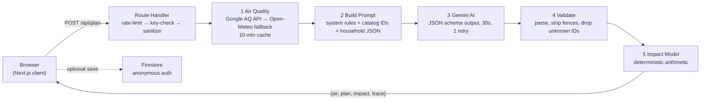

<!-- generated-by: harness v1 | source: raw.md@9368F0589D239760FA754D1BBC150512E653F2FBA66FC40D0430CD44D7AD916B | hash: pending-first-run -->

# harness.md — BreatheWise

> **Source of truth.** Every agent, role, sprint and gate is derived from this file.
> Link back: [docs/raw.md](raw.md) · [docs/prompt.md](prompt.md)

---

## 1. Problem Statement

Severe winter smog (Delhi-NCR, Indo-Gangetic Plain, Lahore, Dhaka, Beijing) causes serious health harm to children, seniors, and people with respiratory conditions. Families receive raw AQI numbers but no actionable, personalised guidance they can afford and act on today.

**BreatheWise** is a chat-free, form-first web assistant. The user provides their location, household profile, and lifestyle, plus their own Gemini AI API key. The app:
1. Fetches live air quality for the location (Google AQ API → Open-Meteo fallback).
2. Sends a structured prompt to Gemini AI and receives a JSON plan of action IDs.
3. Maps every suggested action to a curated catalog and computes deterministic PM2.5 exposure impact (the LLM explains; the code does the arithmetic — no hallucinated health numbers).

Full problem statement: [docs/raw.md](raw.md)

---

## 2. Goals & Non-Goals

### Goals
- G1 Personalised, actionable smog-season routine from one form submission.
- G2 Quantified, transparent impact (PM2.5 reduction %, cigarette-equivalents, CO2 saved) — deterministic arithmetic only.
- G3 BYO Gemini key — zero model cost to operator; near-zero hosting on free tiers.
- G4 Works for low-budget families (cheap actions first), multilingual (en/hi/mr).
- G5 Privacy-safe: user key never logged, never written server-side; Firestore optional.
- G6 Production-ready: CSP, HSTS, rate limiting, container hardening, CI/CD pipeline.

### Non-Goals
- Not a medical device; not real-time sensor hardware.
- No community aggregation in v1 (roadmap item).
- No forecasting in v1.
- No user accounts (anonymous auth only).
- No charging / monetisation in v1.

---

## 3. Users & Use Cases

| User | Primary Need | Key Constraint |
|---|---|---|
| Parents | Safe school-run, play, and sleep plan | Understandable language, mobile-friendly |
| Seniors / asthma households | Conservative guidance, escalation to doctor | Clear warnings, no jargon |
| Low-budget families | Cheap and free options first (DIY box-fan, wet-mop) | No upsells |
| Communities / RWAs | Collective impact (carpool, no waste burning) | Shareable output |

**Primary user:** parent or caregiver in a polluted South/East Asian city.
**Out of scope:** medical professionals requiring clinical-grade data, IoT sensor integration.

---

## 4. Requirements

| ID | Statement | Priority | Source |
|---|---|---|---|
| REQ-001 | User can enter location (GPS or city text) and get live AQI from Google AQ API with Open-Meteo fallback | MUST | raw.md §5 |
| REQ-002 | User submits household form (home type, cooking fuel, commute, budget, outdoor hours, existing purifier, medical notes) | MUST | raw.md §2 |
| REQ-003 | App sends sanitised profile to Gemini AI, receives a structured JSON plan of action IDs | MUST | raw.md §5 |
| REQ-004 | Every AI-suggested action is validated against the curated catalog (`src/lib/catalog.ts`); unknown IDs are dropped | MUST | raw.md §5 |
| REQ-005 | Deterministic impact model computes PM2.5 reduction %, cigarette-equivalents, CO2 saved | MUST | raw.md §6 |
| REQ-006 | User can optionally save/retrieve their plan via Firebase Firestore (anonymous auth) | SHOULD | raw.md §4 |
| REQ-007 | App handles all error edge cases (key errors, quota, bad JSON, geolocation denied, AQ unavailable) with user-facing messages | MUST | raw.md §9 |
| REQ-008 | Gemini API key: browser → route handler → Google only; never logged, never stored server-side | MUST | raw.md §7 |
| REQ-009 | Rate limit: 8 req/min/IP sliding window; body cap 8 KB; response timeout 50s client-side | MUST | raw.md §7,§8 |
| REQ-010 | Security headers: CSP, HSTS, nosniff, frame-ancestors none, Referrer-Policy, Permissions-Policy | MUST | raw.md §7 |
| REQ-011 | Responsive to 360 px; keyboard-navigable; AA contrast; reduced-motion respected | MUST | raw.md §13 |
| REQ-012 | All tracked files < 10 MB; enforced by `scripts/check-size.ts` in CI | MUST | raw.md §3 |
| REQ-013 | UI multilingual: English, Hindi (hi), Marathi (mr) | SHOULD | raw.md §4 |
| REQ-014 | AQI ≥ 300: show UI banner + escalate to medical care | MUST | raw.md §9 |
| REQ-015 | Container: non-root bun user, slim image, read-only FS, no-new-privileges | MUST | raw.md §7 |
| REQ-016 | CI pipeline: typecheck → tests → size check → build → docker build + smoke test → deploy (main only) | MUST | raw.md §10,§11 |

---

## 5. Acceptance Criteria

| ID | REQ | Given / When / Then |
|---|---|---|
| AC-001-a | REQ-001 | Given a valid city name, When the user submits, Then the app returns current AQI and PM2.5 from Google AQ API within 8 s |
| AC-001-b | REQ-001 | Given Google AQ API unavailable, When the user submits, Then Open-Meteo AQI data is returned and the UI notes the fallback |
| AC-001-c | REQ-001 | Given GPS permission granted, When user clicks "Use my location", Then lat/lon geocodes and AQI fetches without further text input |
| AC-002-a | REQ-002 | Given the household form, When all required fields are filled, Then submission is accepted and the profile is included in the Gemini prompt |
| AC-003-a | REQ-003 | Given a valid key and profile, When submitted, Then Gemini returns a JSON plan with ≥ 1 valid action ID within 30 s |
| AC-003-b | REQ-003 | Given a 5xx from Gemini, When one retry fails, Then the app returns HTTP 502/504 with error code `GEMINI_FAIL` |
| AC-004-a | REQ-004 | Given Gemini returns unknown action IDs, When validated, Then those IDs are dropped; if none remain, error code `MODEL_EMPTY` is returned |
| AC-005-a | REQ-005 | Given a plan with N95 outdoor action, When impact is computed, Then PM2.5 reduction is 60% × (outdoorHours/24) with no double-counting |
| AC-005-b | REQ-005 | Given zero PM2.5, When impact is computed, Then reduction is 0% and no divide-by-zero error occurs |
| AC-005-c | REQ-005 | Given multiple same-scope actions, When impact is computed, Then total benefit is capped at 90% |
| AC-006-a | REQ-006 | Given anonymous auth and Firebase configured, When plan is generated, Then user can opt-in to save it; plan is retrievable on next visit |
| AC-006-b | REQ-006 | Given Firebase not configured, When app loads, Then save option is hidden and app functions fully without error |
| AC-007-a | REQ-007 | Given no/malformed Gemini key, When submitted, Then HTTP 401 with code `NO_KEY` or `BAD_KEY` is returned before any network call |
| AC-007-b | REQ-007 | Given Gemini 429, When received, Then HTTP response includes code `QUOTA` and no retry storm occurs |
| AC-007-c | REQ-007 | Given both AQ sources fail, When submitted, Then HTTP 502 with code `AQI_UNAVAILABLE` is returned |
| AC-007-d | REQ-007 | Given geolocation denied, Then inline fallback message prompts manual city entry |
| AC-008-a | REQ-008 | Given a request log, When inspected, Then no Gemini key appears in any log line, URL, or Firestore record |
| AC-009-a | REQ-009 | Given 9 requests in 1 minute from one IP, When the 9th arrives, Then HTTP 429 is returned |
| AC-009-b | REQ-009 | Given a request body > 8 KB, When received, Then HTTP 413 is returned |
| AC-010-a | REQ-010 | Given any HTTP response, When headers inspected, Then CSP, HSTS, X-Content-Type-Options, X-Frame-Options/frame-ancestors, Referrer-Policy, Permissions-Policy are all present |
| AC-011-a | REQ-011 | Given a 360 px viewport, When the UI renders, Then no horizontal scroll and all interactive elements are reachable |
| AC-011-b | REQ-011 | Given `prefers-reduced-motion: reduce`, When the UI renders, Then animations are disabled |
| AC-012-a | REQ-012 | Given a CI push, When `scripts/check-size.ts` runs, Then it exits non-zero if any tracked file exceeds 10 MB |
| AC-014-a | REQ-014 | Given AQI ≥ 300, When plan is displayed, Then a prominent warning banner is shown and advice to seek medical care is included |
| AC-015-a | REQ-015 | Given the Docker image, When inspected, Then user is `bun` (non-root), FS is read-only, and `no-new-privileges` is set |
| AC-016-a | REQ-016 | Given a push to main, When CI runs, Then all gates pass in order and deploy only proceeds if every prior gate is green |

---

## 6. Architecture & Tech Stack

### Stack
| Layer | Technology |
|---|---|
| Runtime / package manager | Bun |
| Framework | Next.js 15 App Router |
| Language | TypeScript (strict) |
| UI | React 19, Tailwind CSS (design system: orange #FF6A13 / cobalt #0047AB) |
| AI | Gemini AI API (plain `fetch`, JSON schema output, no SDK) |
| Air quality | Google Air Quality API (primary) + Open-Meteo (fallback, keyless) |
| Auth | Firebase Anonymous Auth |
| Storage | Cloud Firestore (optional) |
| Analytics | Firebase Analytics (lazy, client-only) |
| Hosting | Firebase Hosting (CDN) + Cloud Run (Docker, scale-to-zero) |
| CI/CD | GitHub Actions → Cloud Build → Artifact Registry → Cloud Run |
| Container | Docker multi-stage, standalone Next.js output |

### Pipeline (server-side, per request)



### Key ADRs (to be recorded in `docs/adr/`)
- ADR-0001: No Gemini SDK — plain `fetch` to keep bundle small and avoid SDK version coupling.
- ADR-0002: BYO key model — zero model cost to operator; documented XSS trade-off for localStorage.
- ADR-0003: Catalog-bound impact arithmetic — LLM explains, code computes, to prevent health misinformation.

---

## 7. Project Structure

```
breathewise/
├── src/
│   ├── app/
│   │   ├── layout.tsx          # root layout, metadata, fonts
│   │   ├── page.tsx            # home page (form entry)
│   │   └── api/
│   │       ├── plan/route.ts   # POST /api/plan — main pipeline
│   │       └── health/route.ts # GET /api/health — container healthcheck
│   ├── components/             # React UI components
│   ├── lib/
│   │   ├── aqi.ts              # AQI fetching & geocoding
│   │   ├── catalog.ts          # curated action catalog (source of truth)
│   │   ├── gemini.ts           # Gemini AI prompt + response handling
│   │   ├── impact.ts           # deterministic PM2.5 impact model
│   │   ├── pipeline.ts         # orchestrates stages 1-5
│   │   ├── sanitize.ts         # input sanitisation & validation
│   │   └── rate-limiter.ts     # 8 req/min sliding window
│   └── types/                  # shared TypeScript types
├── tests/
│   ├── core.test.ts            # unit tests (bun test)
│   └── harness/                # harness self-tests (pytest)
├── scripts/
│   ├── check-size.ts           # repo size gate (< 10 MB)
│   ├── check_harness.py        # harness linter
│   ├── guard_paths.py          # lane/path guard
│   └── breaker.py              # circuit breaker
├── docs/
│   ├── raw.md                  # problem statement
│   ├── harness.md              # this file
│   ├── prompt.md               # orchestrator operating manual
│   ├── mcp.md                  # MCP server catalog
│   ├── mcpguide.md             # MCP policy + role matrix
│   ├── mcpcheck.md             # MCP verification checklist
│   ├── memory/
│   │   ├── interview.md
│   │   ├── assumptions.md
│   │   ├── lessons.md
│   │   └── glossary.md
│   └── adr/                    # Architecture Decision Records
├── harness/
│   ├── profile.yaml
│   ├── agents/                 # skinny agent pointers (≤ 40 lines each)
│   ├── roles/                  # fat role definitions
│   ├── workflows/              # pipeline, sprint-template, parallel-lanes
│   ├── standards/              # coding, testing, git, handoff-contract, definition-of-done
│   ├── tools/                  # registry.yaml, sandbox.md
│   ├── state/                  # state.json, schema, budgets, locks/
│   ├── artifacts/              # per-task artifact directories
│   ├── tasks/                  # task definition files
│   ├── backlog.md
│   └── logs/
├── public/                     # static assets (SVG icon only — no images committed)
├── Dockerfile
├── docker-compose.yml
├── .env.example
├── .firebaserc
├── firebase.json
├── firestore.rules
├── cloudbuild.yaml
├── next.config.ts
├── tsconfig.json
├── AGENTS.md
└── CLAUDE.md
```

**Module ownership (for lane decomposition):**
| Module | Owned files |
|---|---|
| api-pipeline | `src/app/api/plan/route.ts`, `src/lib/pipeline.ts` |
| aqi | `src/lib/aqi.ts` |
| gemini | `src/lib/gemini.ts` |
| catalog-impact | `src/lib/catalog.ts`, `src/lib/impact.ts` |
| sanitize-security | `src/lib/sanitize.ts`, `src/lib/rate-limiter.ts` |
| ui | `src/app/`, `src/components/` |
| infra | `Dockerfile`, `docker-compose.yml`, `cloudbuild.yaml`, `firebase.json`, `firestore.rules` |

---

## 8. Commands

> These are the **only** canonical commands agents may run. All other commands require explicit approval.

| Purpose | Command |
|---|---|
| Install | `bun install` |
| Dev server | `bun dev` |
| Lint | `bun run lint` (next lint) |
| Format check | `bun run format:check` (prettier --check) |
| Format write | `bun run format` (prettier --write) |
| Type-check | `bun run typecheck` (tsc --noEmit) |
| Unit tests | `bun test` |
| Repo size check | `bun run check-size` (scripts/check-size.ts) |
| Build | `bun run build` (next build) |
| Full verify | `bun run verify` (typecheck + tests + size + build) |
| Docker build | `docker build -t breathewise .` |
| Docker run | `docker compose up --build` |
| Harness self-test | `python scripts/check_harness.py && python -m pytest tests/harness` |
| Integration test | `bun test tests/integration` (network-mocked) |

---

## 9. Coding & Testing Standards

### Style
- TypeScript strict mode (`"strict": true`). No `any`; use `unknown` + narrowing.
- ESLint with Next.js config; Prettier for formatting. No `eslint-disable` without comment.
- Functional components, React hooks. No class components.
- Pure functions for all business logic (`aqi`, `impact`, `sanitize`, `catalog`, `gemini`, `pipeline`). Inject dependencies (fetch, env, time) so tests are hermetic.

### Security-specific coding rules
- Never log `x-gemini-key` header or any value matching `*KEY*`, `*TOKEN*`, `*SECRET*`.
- All user free-text sanitised: strip control chars/markup, cap at 300 chars, passed as JSON `<household>` block declared untrusted.
- All Gemini output validated against `responseSchema` enum before use — no dynamic `eval`.
- No `dangerouslySetInnerHTML`. CSP blocks inline scripts.

### Test pyramid
| Layer | Tool | Rule |
|---|---|---|
| Unit | `bun test` | One file per module (`test_<unit>_<behavior>.ts`), < 1 s each, hermetic (no network, deterministic seeds, frozen time) |
| Integration | `bun test tests/integration` | Network mocked; covers full pipeline with injected deps |
| E2E / smoke | Docker smoke test in CI | `GET /api/health` → 200 in built container |

- **Coverage floor**: 80% on changed lines (measured by bun's built-in coverage).
- **Tests-first**: Test Author writes failing tests from AC IDs; Builder makes them green.
- **Forbidden cheating**: deleting/skipping tests, `// @ts-ignore`, `eslint-disable`, snapshot blind-updates.

### Impact model rules
- Indoor PM2.5 = 60% of outdoor (leaky home), 36% with purifier.
- Action efficiencies in `catalog.ts`; multiplicative stacking; total capped at 90%.
- Cigarette-equivalent: 22 µg/m³ (24h) ≈ 1 cigarette (labelled approximate).
- Every result carries a caveat string.

---

## 10. Tools, APIs & MCP Servers

See `harness/tools/registry.yaml` for the full permission matrix.

| Tool / API | Purpose | Approval |
|---|---|---|
| `file_read` | All agents read source/artifacts | auto |
| `file_write` | Role-scoped via `guard_paths.py` | auto |
| `bash` | Builder, Test Author, QA, Security only | auto (sandboxed) |
| `git` | Orchestrator, Builder | auto (no force-push, no reset --hard origin) |
| `bun install` | Builder only (new deps need approval) | confirm |
| `deploy` | Forbidden for all agents | forbidden |
| Gemini AI API | Test-only: mocked in unit tests | auto (mocked) |
| Google AQ API | Test-only: mocked in unit tests | auto (mocked) |
| `semgrep` (MCP) | Security scans changed files at G1 | auto |
| `github` (MCP) | Librarian/PO-Spec read PRs/issues | auto |
| `context7` (MCP) | Tech Lead fetches library docs | auto |

**MCP servers active:** `semgrep`, `github`, `context7` — see `docs/mcp.md` and `.mcp.json`.

---

## 11. Autonomy & Approval Matrix

| Action | Approval required? | Who approves |
|---|---|---|
| Write/edit source files (within lane) | No | — |
| Install new npm/bun package | Yes | User |
| Run docker build / compose | No | — |
| Deploy to Cloud Run / Firebase | **Forbidden** for agents | User only |
| DB migrations (Firestore rules change) | Yes | User |
| Modify `firestore.rules` | Yes | User |
| Delete files outside `./tmp` or build output | Yes | User |
| Make network calls to non-allow-listed hosts | Forbidden | — |
| Edit `docs/raw.md` or `docs/harness.md` content | Forbidden | — |

---

## 12. Sprint Plan

### Sprint 0 — Scaffold the Harness
**Goal:** Harness exists and is fully self-testing.
**Exit gate:** `python scripts/check_harness.py` ✅ · `pytest tests/harness` ✅ · User approves.
**Tasks:** Create all files in §4 layout; configure agents, roles, standards, registry, `AGENTS.md`, IDE adapters; derive from raw.md. *(Running now.)*

### Sprint 1 — Walking Skeleton
**Goal:** End-to-end: form → AQI fetch → Gemini call → impact computation → result displayed. All mocked in tests; real network only in Docker smoke test.
**Tasks:**
- T-0001: `src/lib/catalog.ts` — curated action catalog (data layer, no network)
- T-0002: `src/lib/impact.ts` — deterministic PM2.5 impact model (pure functions)
- T-0003: `src/lib/sanitize.ts` + `rate-limiter.ts` — input validation & rate limiting
- T-0004: `src/lib/aqi.ts` — AQI fetch with fallback + 10-min cache
- T-0005: `src/lib/gemini.ts` — Gemini prompt builder + response validator
- T-0006: `src/lib/pipeline.ts` + `src/app/api/plan/route.ts` — full pipeline + route
- T-0007: `src/app/` + `src/components/` — UI form + result display (walking skeleton)
**Exit gate:** All §9 gates green; full artifact trail; `bun run verify` passes.

### Sprint 2 — Hardening & Production Readiness
**Goal:** Security hardening, Firebase integration, CI/CD pipeline, accessibility.
**Tasks:**
- T-0008: Security headers, CSP, container hardening
- T-0009: Firebase Auth + Firestore optional save/retrieve
- T-0010: GitHub Actions CI/CD (typecheck → test → size → build → docker → deploy on main)
- T-0011: Accessibility (a11y) — 360px responsive, keyboard nav, reduced-motion
- T-0012: Multilingual strings (en/hi/mr)
**Exit gate:** All gates + demo checklist + user sign-off.

### Sprint 3 — Retro & Release
**Goal:** Final hardening, docs, release readiness.
**Tasks:** Perf audit, security audit, README, changelog, final AGENTS.md update.
**Exit gate:** Release checklist + user sign-off.

---

## 13. Risks & Mitigations

| Risk | Likelihood | Impact | Mitigation |
|---|---|---|---|
| Gemini returns hallucinated action IDs | High | High | Catalog validation; unknown IDs dropped; `MODEL_EMPTY` if all invalid |
| User Gemini key logged accidentally | Medium | Critical | Log scrubbing rule in standards; secret scan in G1 (`semgrep`) |
| Prompt injection via household notes | Medium | High | Strip + cap free text; wrap in `<household>` with `untrusted` declaration; output is enum-constrained |
| Google AQ API rate limits or downtime | Medium | Medium | Open-Meteo fallback; 10-min cache; `AQI_UNAVAILABLE` graceful error |
| Repo size > 10 MB (accidental asset commit) | Low | Medium | `check-size.ts` in CI; no images/fonts committed |
| Firebase Firestore misconfiguration → data leak | Low | High | Owner-only rules; create-only; field allow-list; default deny; rules in CI |
| XSS reads localStorage key | Low | High | Strict CSP; no third-party scripts; no `dangerouslySetInnerHTML`; documented trade-off |

---

## 14. Assumptions

| ID | Statement | Date | Status |
|---|---|---|---|
| ASM-001 | `bun.lock` will be committed after the first `bun install` on a networked machine (raw.md §15) | 2026-11-24 | Open |
| ASM-002 | Google Air Quality API server key is optional; Open-Meteo fallback covers keyless operation | 2026-11-24 | Confirmed by raw.md |
| ASM-003 | Firebase project creation and Firestore provisioning are manual steps (not automated by agents) | 2026-11-24 | Confirmed by raw.md §12 |
| ASM-004 | The existing `docs/Mcp.md`, `docs/McpCheck.md`, `docs/Mcpguide.md` (with capital letters) are canonical — to be normalised to lowercase filenames | 2026-11-24 | Confirmed by user |
| ASM-005 | No git repository exists yet; agents will not run git commands until `git init` is done by user or Sprint 0 | 2026-11-24 | Open |
| ASM-006 | Sprint length is by-task (no fixed cadence); tasks are completed before the next starts | 2026-11-24 | Confirmed by user |
| ASM-007 | Maximum parallel builder lanes is 2 | 2026-11-24 | Confirmed by user |

---

## 15. Open Questions

*(Must be empty before Sprint 1 starts.)*

- OQ-001: Should `bun.lock` be committed as part of Sprint 0, or will the user run `bun install` manually before Sprint 1? *(Blocks T-0001 if network is unavailable in agent environment)*
- OQ-002: Is the Google Air Quality API server key available for local dev, or should agents assume keyless (Open-Meteo only) until explicitly provided?

---

## 16. Definition of Done

A task is **Done** only when **all** are true:
- [ ] Artifacts `01`–`08` exist for the task and every handoff JSON validated
- [ ] G0–G4 all pass with logged evidence in `events.jsonl`
- [ ] Every `AC-*` has ≥ 1 passing test or recorded manual evidence
- [ ] No new lint/type warnings; no skipped/xfail tests added; coverage ≥ 80% on changed lines
- [ ] Reviewer: 0 BLOCKER/MAJOR · Security: 0 high/critical · Docs updated
- [ ] No secret patterns in diff (`semgrep` clean, `check_harness.py` secret check clean)
- [ ] Guard clean; no breaker tripped; no unresolved open questions
- [ ] `state.json`, logs, and `lessons.md` updated; commit follows `harness/standards/git.md`
- [ ] `AGENTS.md` still accurate (Librarian verified, ≤ 150 lines)

---

## 17. Glossary

| Term | Definition |
|---|---|
| AQI | Air Quality Index (0–500+); values ≥ 300 trigger escalation banner |
| PM2.5 | Particulate matter ≤ 2.5 µm; primary health harm metric used in the impact model |
| Catalog | `src/lib/catalog.ts` — the authoritative list of action IDs, efficiencies, costs, and scopes |
| Impact model | Deterministic arithmetic (not AI) computing PM2.5 reduction % from selected catalog actions |
| BYO key | Bring-Your-Own Gemini API key — the user supplies it; the operator pays nothing for model calls |
| Lane | A parallel Builder worktree owning a disjoint set of files (see §6.2 parallelism rules) |
| Harness | The scaffold of agents, roles, standards, scripts, and gates defined in `docs/prompt.md` |
| G0–G5 | Quality gates defined in `docs/prompt.md §9.1` |
| WIF | Workload Identity Federation — keyless GitHub Actions → GCP auth |
