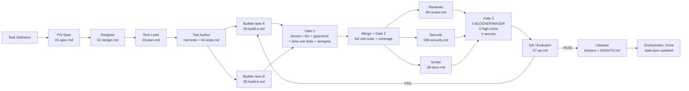

<!-- generated-by: harness v1 | source: harness.md -->
# Pipeline — BreatheWise

## Stage graph

## Parallelism rules
- **Parallel**: Builder lane A ‖ lane B (disjoint file ownership per `03-plan.md`).
- **Parallel after merge**: Reviewer ‖ Security ‖ Scribe.
- **Sequential (hard dependencies)**: PO-Spec → Designer → Tech Lead → Test Author → Builders → G1/G2 → {Review, Security, Docs} → G3 → QA.
- Max parallel agents: `harness/state/budgets.json.max_parallel_agents` (2).

## Handoff protocol
Every stage emits a handoff JSON: `harness/artifacts/<TASK-ID>/handoff-<from>-to-<to>.json`.
See `harness/standards/handoff-contract.md` for schema and rejection rules.

## Failure handling
- QA FAIL: return to the named stage with incremented `attempts` counter.
- Breaker trips if `max_stage_retries` exceeded: see `scripts/breaker.py`.
- Guard violation (file outside allow-list): **immediate** breaker trip.
